# CrossMgr Antenna Planner — Manual

Plan, simulate and tune UHF RFID finish-line antennas for motocross timing with
[CrossMgrImpinj](https://github.com/esitarski/CrossMgr/tree/master/CrossMgrImpinj) and crossmgr-interface.

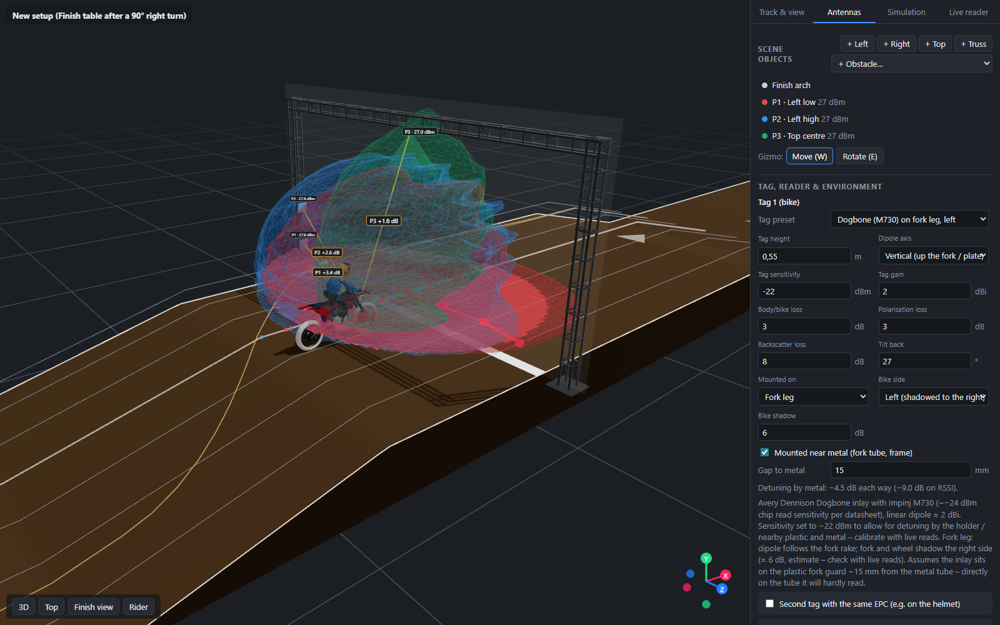

You build the finish area in 3D: track with turns, ramps and a finish table, the aluminium finish arch, antennas, obstacles, the bike and its tags. The planner then shows:

- where tags can be read;
- where the timing fires for straight lanes and realistic rider lines (the **virtual wall**);
- how to set per-antenna power, or even the best antenna layout;
- at the track: live reads from the Impinj reader, used to calibrate the model.

---

## Contents

1. [Quick start](#1-quick-start)
2. [The screen](#2-the-screen)
3. [Tutorial: planning a finish table after a right turn](#3-tutorial-planning-a-finish-table-after-a-right-turn)
4. [Track & view tab](#4-track--view-tab)
5. [Antennas tab](#5-antennas-tab)
6. [Simulation tab](#6-simulation-tab)
7. [Live reader tab](#7-live-reader-tab)
8. [Workflows](#8-workflows)
9. [How the model works](#9-how-the-model-works)
10. [Reading the results – lessons learned](#10-reading-the-results--lessons-learned)
11. [Files and data](#11-files-and-data)
12. [Installation, ports and troubleshooting](#12-installation-ports-and-troubleshooting)
13. [Development](#13-development)
14. [Limitations](#14-limitations)
15. [Credits](#15-credits)

---

## 1. Quick start

**Docker (recommended)**

```bash
docker compose up -d --build
```

Open **http://localhost:18787**. Use `HOST_PORT=18789 docker compose up -d` for another port. The container contains the web app and the live-reader backend. It connects out to the reader (LLRP, TCP 5084) over normal Docker networking.

**Without Docker (development)**

```bash
cd web && npm install && npm run dev                      # web app: http://localhost:5173
cd server && python -m venv .venv
.venv/Scripts/pip install -r requirements.txt             # Linux/macOS: .venv/bin/pip
.venv/Scripts/python app.py                               # backend: http://localhost:18787
```

**First five minutes**

1. *Track & view* → pick **Finish table after a 90° right turn** → **New setup**.
2. Look at the 3D view: coloured bubbles are the read zones of the three antennas.
3. *Simulation* → read the **Virtual wall** numbers (offset, spread, missed).
4. Press **Optimise power** or **Find best layout** and apply the suggestion.
5. *Live reader* → **Simulated from model** → **Start riders** to see the whole live workflow without hardware.

---

## 2. The screen

| Area | What it does |
| --- | --- |
| **3D view** (left) | Drag = orbit, right-drag = pan, wheel = zoom. Click an object to select it; click empty space or press `Esc` to deselect. |
| Camera buttons (bottom left) | **3D**, **Top**, **Finish view** (looking along the finish line), **Rider** (riding towards the finish). |
| Gizmo (on the selected object) | `W` = move, `E` = rotate. Trusses and obstacles only move on the ground and rotate about the vertical axis. |
| Axis widget (bottom right) | Red **X** = direction of travel at the finish, blue **Z** = to the rider's right, green **Y** = up. |
| Sidebar tabs (right) | **Track & view**, **Antennas**, **Simulation**, **Live reader**. |

**Coordinates.** The finish line is always at the centre of the view. X = 0 is the finish plane, riders travel in +X there, +Z is the rider's right, Y is absolute elevation in metres. Lateral positions such as "−3.5 m" are measured from the track centre, negative = left.

Everything recalculates automatically, about 0.2 s after the last change. The setup is kept in the browser between sessions. Use **Export** to keep it as a file.

---

## 3. Tutorial: planning a finish table after a right turn

This walkthrough uses the example the screenshots show. The finish arch stands on a 1.2 m high finish table directly after a 90° right turn. Two antennas are on the left upright, one hangs from the crossbar. Riders carry an Avery Dennison Dogbone (Impinj M730) on the left fork leg.

**Step 1 – Track.** *Track & view* → preset *Finish table after a 90° right turn* → **New setup**. The track is approach → right turn (R 10 m) → 5 m ramp up +1.2 m → 14 m table (finish 4 m in) → ramp down → run-out.

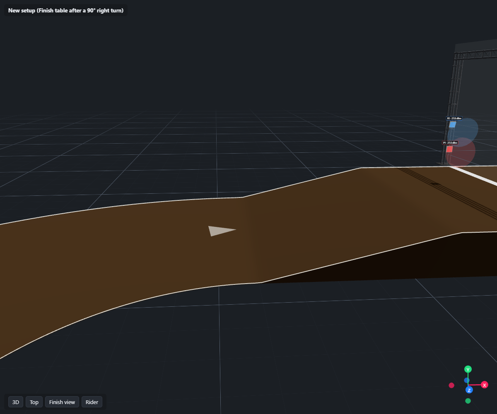

Adjust lengths, radius, heights and widths to your venue (see [4.2](#42-track-segments)).

**Step 2 – Arch.** Set the real clear height and span of your truss under *Finish arch (truss)*. If a warning says the uprights stand on the track, press **Fit span to track**.

**Step 3 – Antennas.** *Antennas* tab: the default antennas are mounted on the truss (left low 0.7 m, left high 1.8 m, crossbar centre). Select one to change height, aim, power or model. Mounted antennas follow the truss.

**Step 4 – Tag.** Choose the tag preset that matches how your riders carry the tag. If they also wear a helmet tag with the same EPC, enable **Second tag** (see [5.6](#56-second-tag-with-the-same-epc)).

**Step 5 – Check coverage.** Look at the read zones and the heatmap at tag height. Everything the riders can use should be covered, ideally by at least two antennas.

**Step 6 – Simulate.** *Simulation* → check the **Virtual wall**. The goal is 0 % missed, mean offset close to 0 and a small spread, also for the corner-cut line (riders coming in on the right edge and crossing next to the left antennas).

**Step 7 – Optimise.** **Optimise power** tunes the current layout; **Find best layout** also moves antennas on the arch. Apply what you like.

**Step 8 – At the track.** Stop CrossMgrImpinj, connect the planner to the reader, push the antenna config and walk or ride a test tag through marked lanes. The **Calibration** table corrects the model (see [8.2](#82-at-the-track-calibration)). Re-optimise, then enter the final per-port powers in CrossMgrImpinj.

---

## 4. Track & view tab

### 4.1 Setup

- **Name**, **Export** (JSON file), **Import**, and **New setup** from a preset. *New setup* replaces track, arch, antennas and tags.
- Presets: straight · finish after a right / left turn · finish before a right / left turn · **finish table after a 90° right / left turn**.

### 4.2 Track segments

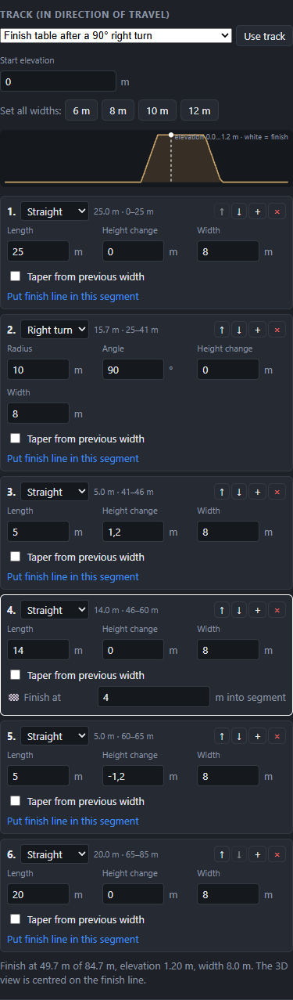

The track is a chain of segments in the direction of travel:

| Field | Meaning |
| --- | --- |
| Type | Straight, left turn or right turn |
| Length | Straight segments |
| Radius, Angle | Turns: centreline radius and turn angle |
| Height change | Elevation gained (+) or lost (−) over the segment: ramps, tables, drops |
| Width / Width at end | Track width. With **Taper from previous width** the width changes gradually over the segment, otherwise it changes at the segment start |
| 🏁 Finish at | Only on the finish segment: distance from the segment start to the finish line |

Buttons per segment: ↑ ↓ move, **+** insert after, **×** delete, **Put finish line in this segment**. **Use track** replaces only the track with a preset (arch and antennas stay). **Set all widths** sets every segment to 6/8/10/12 m. **Start elevation** raises or lowers the whole track.

The elevation profile shows the layout; the white line is the finish. Beyond both ends the track continues straight and level, so simulations never run off the end.

Example of changing widths: a 6 m approach, tapering to a 10 m finish table, tapering back:

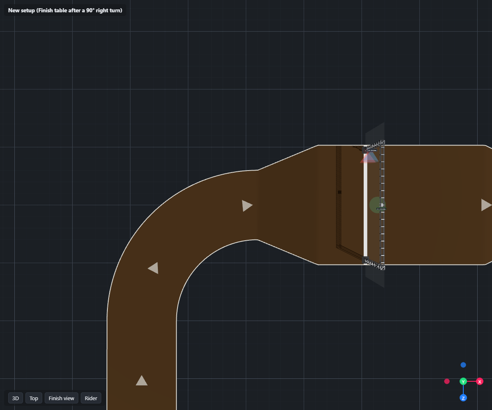

### 4.3 Finish arch (truss)

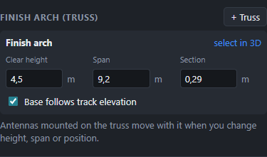

- **Clear height** = height of the crossbar centre above the truss base; **Span** = distance between upright centres; **Section** = truss profile edge (e.g. 0.29 m).
- **Base follows track elevation**: the arch stands on the track surface under it (on the table). Switch off to set a manual **Base elevation**.
- The warning *Uprights stand on the track* appears when the span is smaller than the finish width. **Fit span to track** widens it.
- **+ Truss** adds another arch. **select in 3D** selects it for the gizmo.

### 4.4 View

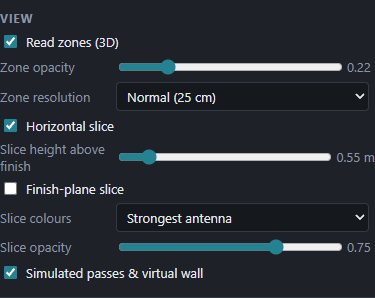

| Setting | Meaning |
| --- | --- |
| Read zones (3D) | Surface of the area in which each antenna can read the tag (link margin ≥ 0), one colour per port |
| Zone opacity / resolution | Transparency; grid step 40 / 25 / 15 cm (finer = slower) |
| Horizontal slice + height | Heatmap in a horizontal plane, height measured above the finish surface |
| Finish-plane slice | Heatmap in the vertical finish plane |
| Slice colours | **Strongest antenna** (port colour), **Antenna overlap count**, **Best RSSI**, **Link margin (0–20 dB)**, **What limits the read** (see below) |
| Simulated passes & virtual wall | Lanes and rider lines, reads of the selected line, the virtual wall |

| Strongest antenna | Overlap count | Best RSSI |
| --- | --- | --- |
| 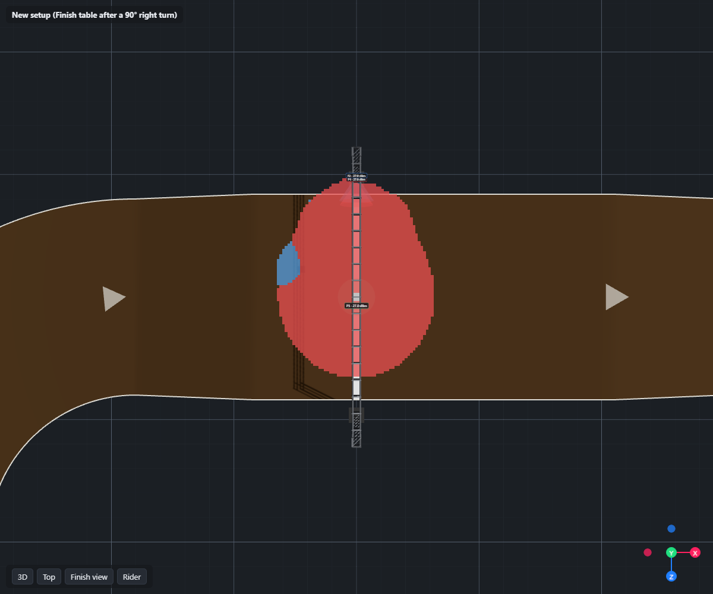 | 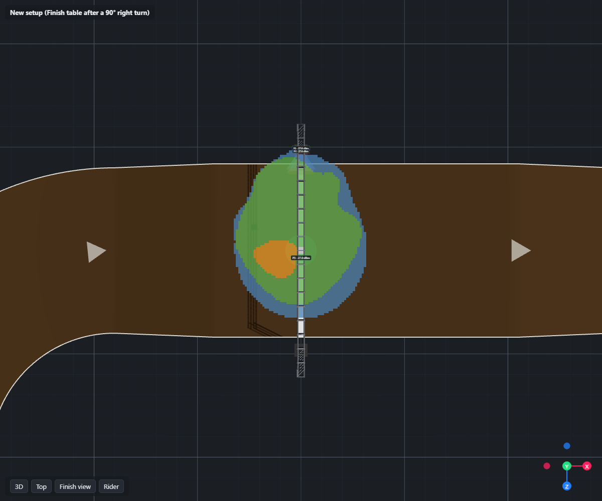 | 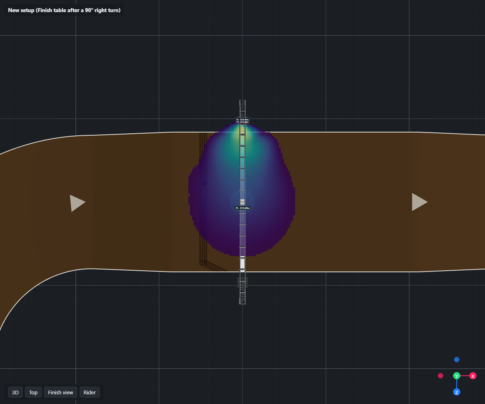 |

**What limits the read.** When a zone is small or there is a gap, this mode shows why, for the best antenna at each spot:

| Colour | Meaning | What helps |
| --- | --- | --- |
| Green – Readable | at least one antenna reads the tag | – |
| Violet – Tag mounting | an ideal tag would be read here; the dipole orientation, bike shadow or metal prevents it | another antenna position / aim, tag orientation, spacer from metal |
| Orange – Obstacles / table edge | without obstacles or the raised track body it would be read | move the antenna or the obstacle, raise the antenna |
| Red – Tag not powered | the forward link is too weak: not enough power reaches the tag | more Tx power, closer / better aimed antenna |
| Blue – Reply too weak | the tag answers, but below the reader's Rx sensitivity | better Rx sensitivity, less cable loss, closer antenna |

Example: the default layout (two antennas on the left upright, one on the crossbar; top view, rider's left at the top), with pessimistic values (Rx −70 dBm, 10 dB bike shadow, left) and with the defaults (Rx −80 dBm, 6 dB, right).

- **Pessimistic values:** the readable area (green) stays near the left upright. Around it, the tag mounting is the limit (violet): the fork tag sits 15 mm from the metal tube (4.5 dB each way), leans 27° back, and is weak towards the overhead antenna. Further out the reply is too weak (blue).
- **Defaults:** the readable area covers most of the table. The violet ring shows that a better-mounted tag (more spacing from metal) would extend it further; beyond that the tag is not powered (red).

| Rx −70 dBm, 10 dB shadow | Rx −80 dBm, 6 dB shadow (defaults) |
| --- | --- |
| 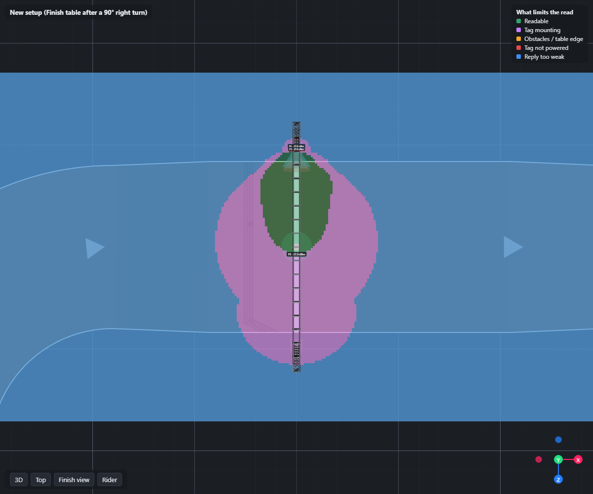 | 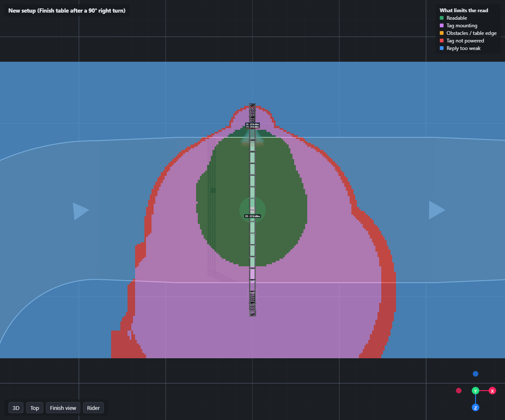 |

The legend is also shown in the 3D view. This mode takes about three times longer to compute than the others.

The finish-plane slice shows what each antenna covers across the track at every height:

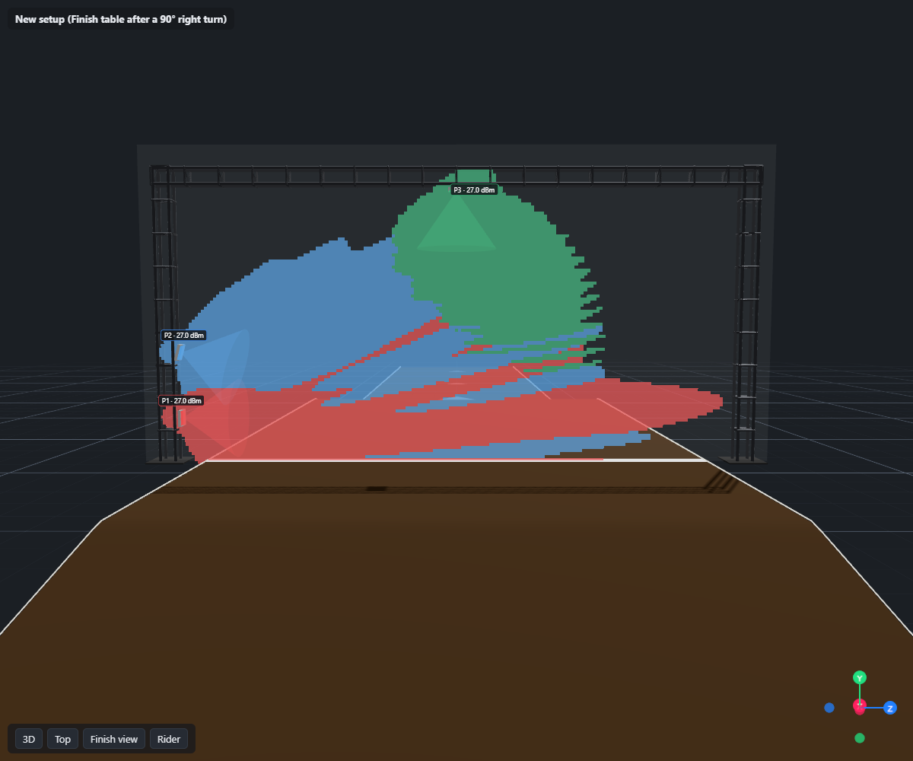

The 3D read zones:

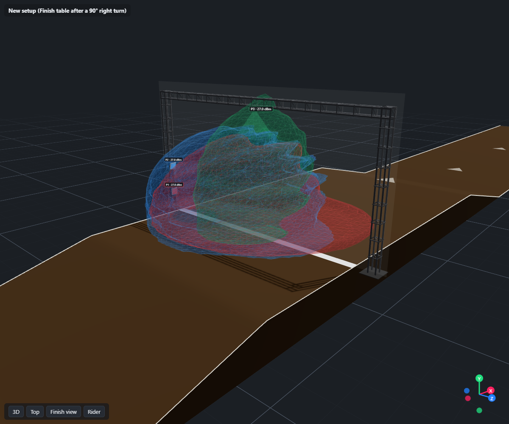

Read zones and heatmaps assume a tag travelling straight through the finish (+X) with the tag-1 orientation. The pass simulation follows the real line, curve and elevation.

---

## 5. Antennas tab

### 5.1 Scene objects

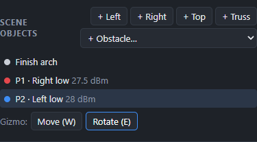

- **+ Left / + Right / + Top** adds an antenna mounted on the first truss (left or right upright pointing across, or crossbar pointing down). **+ Truss** adds an arch. **+ Obstacle…** adds an obstacle (see 5.4).
- Click an entry to select it. **Gizmo: Move (W) / Rotate (E)**.

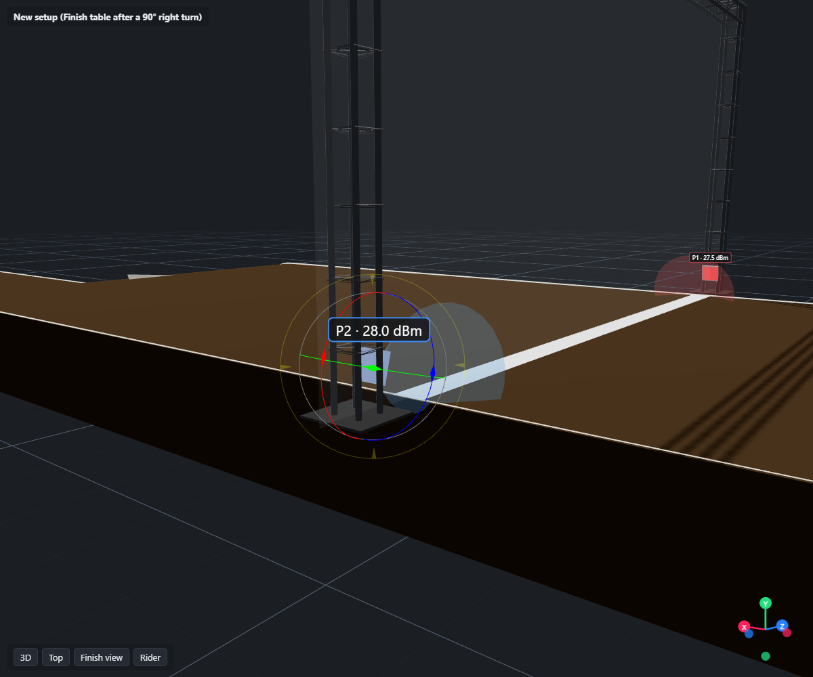

### 5.2 Antenna properties

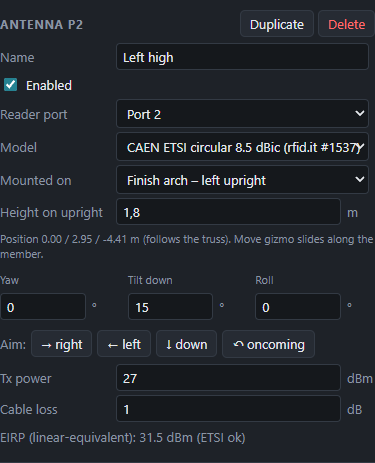

| Field | Meaning |
| --- | --- |
| Enabled | Disabled antennas are ignored everywhere |
| Reader port | 1–4, used for colours, the live config and calibration |
| Model | Antenna model (see 5.8) |
| Mounted on | *Free* or a truss member (left/right upright, crossbar). Mounted antennas follow the truss. |
| Height on upright / Offset on bar | Position along the member (crossbar: + = right of centre) |
| X / Y / Z | Position when free (Y = absolute elevation) |
| Yaw | 0 = pointing +Z (from the left side across the track), 180 = pointing −Z, −90 = towards oncoming riders |
| Tilt down | 0 = horizontal, 90 = straight down |
| Roll | Rotation about the boresight (no effect for circular antennas) |
| Aim buttons | → right · ← left · ↓ down · ↶ oncoming |
| Tx power | Reader output power for this port (reader limits, 0.25 dB steps) |
| Cable loss | Cable + connectors, one way |

The **EIRP** line checks the ETSI limit of 2 W ERP (35.15 dBm EIRP). A circular antenna's dBic gain counts as dBil + 3 dB. Antennas over the limit show ⚠ in 3D.

### 5.3 Truss properties

Select a truss in 3D or the list: position X/Z, yaw, span, clear height, section, base follows track / base elevation.

### 5.4 Obstacles

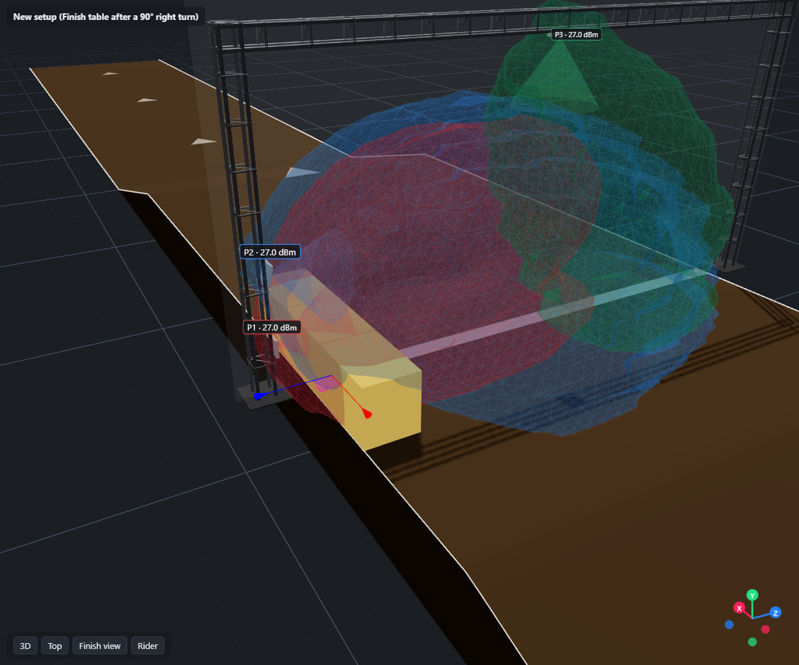

Obstacles are rows of identical boxes that weaken the signal. Rays that pass through lose a fixed amount per crossing, plus a loss per metre travelled inside. This applies to the direct ray and both halves of the ground-reflected ray, capped at 40 dB.

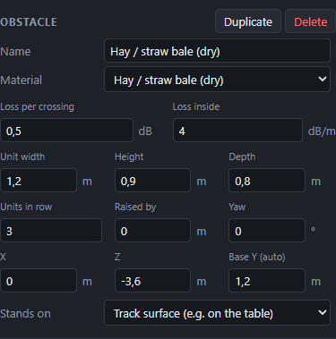

| Material | per crossing | per metre |
| --- | --- | --- |
| Hay / straw bale (dry) | 0.5 dB | 4 dB/m |
| Hay / straw bale (damp) | 1 dB | 15 dB/m |
| Mesh banner (PVC) | 1.5 dB | – |
| Solid banner / tarp (PVC) | 3 dB | – |
| Water-filled plastic barrier | 1 dB | 60 dB/m |
| Tyre wall | 1 dB | 10 dB/m |
| Wooden board / pallets | 1 dB | 6 dB/m |
| Metal crowd barrier / fence | 12 dB | – |
| Spectators / people | 3 dB | 8 dB/m |
| Vehicle / container / timing box (metal) | 30 dB | – |

Fields: size of one unit, **Units in row**, **Raised by** (banner on a fence), yaw, position. **Stands on**: *ground beside the track* (Y = 0), *track surface* (e.g. on the table) or *manual elevation*. **Duplicate** places a copy next to the row. Water content matters most: a damp bale absorbs far more than a dry one.

### 5.5 Tag, reader & environment

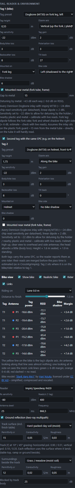

**Tag** (tag 1 = on the bike):

| Field | Meaning |
| --- | --- |
| Tag preset | See the table below |
| Tag height | Height above the track surface |
| Dipole axis | *Vertical* (up the fork / plate), *across the bike*, *along the bike*, *isotropic* (ideal) |
| Tilt back | The axis leans back towards the rider: fork rake ≈ 27°, front plate ≈ 25° |
| Tag sensitivity / gain | Turn-on sensitivity and antenna gain of the tag |
| Body/bike loss | Detuning by bike, body, mud (each way) |
| Polarisation loss | Circular reader antenna → linear tag: 3 dB |
| Backscatter loss | Modulation efficiency of the reply |
| Mounted on | Fork leg, front plate, side plate, helmet – where the 3D bike shows the tag |
| Bike side + Bike shadow | A left-side tag is hidden from right-side antennas by fork, wheel, engine; a front-plate tag from behind. The loss rises to the set value towards the fully shadowed side |
| Mounted near metal + Gap | Detuning of a dipole inlay near metal (see below) |

**Tag presets**

| Preset | Height | Axis | Notes |
| --- | --- | --- | --- |
| Dogbone (M730) on fork leg, left | 0.55 m | vertical, 27° back | on the fork guard, 15 mm from the tube; right side shadowed 6 dB |
| Dogbone (M730) on front number plate, horizontal | 0.95 m | across | weak towards side antennas; 6 dB shadow from behind |
| Dogbone (M730) on front number plate, vertical | 0.95 m | vertical, 25° back | good towards side antennas; 6 dB shadow from behind |
| Dogbone (M730) under side number plate, left | 0.75 m | along | right side shadowed 8 dB |
| Dogbone (M730) on helmet | 1.75 m | along | for the second tag |
| Generic fork / plate / helmet tags | | | older generic values |

The Dogbone presets use −22 dBm sensitivity: the M730 chip's ~−24 dBm read sensitivity, minus ~2 dB for mounting. The bike-shadow values are estimates (signal bends around the bike). Calibrate both with live reads.

**Metal.** A plain dipole inlay directly on metal is practically shorted. The planner uses this detuning (each way):

| Gap to metal | 0 mm | 2 mm | 5 mm | 10 mm | 15 mm | 20 mm | 40 mm | ≥ 80 mm |
| --- | --- | --- | --- | --- | --- | --- | --- | --- |
| Loss | 25 dB | 16 dB | 10 dB | 6 dB | 4.5 dB | 3 dB | 1 dB | 0 dB |

**Reader**: model (Impinj Speedway R420 / R700), **Rx sensitivity** (the reader's receive threshold, default −80 dBm; often the limiting factor, see [10](#10-reading-the-results--lessons-learned)), reads per second for one tag, antenna dwell time, frequency. Set it to what CrossMgrImpinj configures on your reader. As far as I know, Impinj readers use their most sensitive setting unless told otherwise.

**Ground reflection.** One reflected ray is added coherently, so reflections can add up or cancel. It bounces off the surface where it actually lands:

- on the track (table top, ramps), at that elevation, with the **track surface** material;
- beside the track, on the terrain at Y = 0, with the **surroundings** material.

| Ground preset | εr | σ (S/m) | Roughness |
| --- | --- | --- | --- |
| Hard-packed clay soil (moist) | 15 | 0.05 | 3 cm |
| Wet clay / mud | 25 | 0.2 | 5 cm |
| Dry soil / loam | 6 | 0.005 | 3 cm |
| Grass / meadow (moist soil) | 12 | 0.02 | 5 cm |
| Dry sand | 3.5 | 0.001 | 5 cm |
| Wet sand | 20 | 0.05 | 5 cm |
| Asphalt | 5 | 0.005 | 0.5 cm |
| Concrete | 6.5 | 0.02 | 0.5 cm |

A hint shows how strongly the track surface reflects at 10° and 45°. **Blocked by track body** (default 25 dB) is added when the direct ray passes through the raised track, e.g. an antenna below the table edge looking at a tag on the table.

### 5.6 Second tag with the same EPC

Many riders carry a backup tag with the **same EPC**, e.g. on the helmet. Tick **Second tag with the same EPC** and pick a preset (*Dogbone (M730) on helmet*).

- Tag 2 is placed rigidly relative to tag 1 on the bike and rider (the helmet is higher and ~0.3 m behind the fork).
- Both tags answer in every inventory round. Because the EPC is the same, their reads are merged before the pass time is estimated, like CrossMgrImpinj does.
- The RSSI chart shows tag-2 reads as hollow circles; the bike view shows both tags (T1, T2) and their links.

See [10](#10-reading-the-results--lessons-learned) for what this does to timing.

### 5.7 Bike view

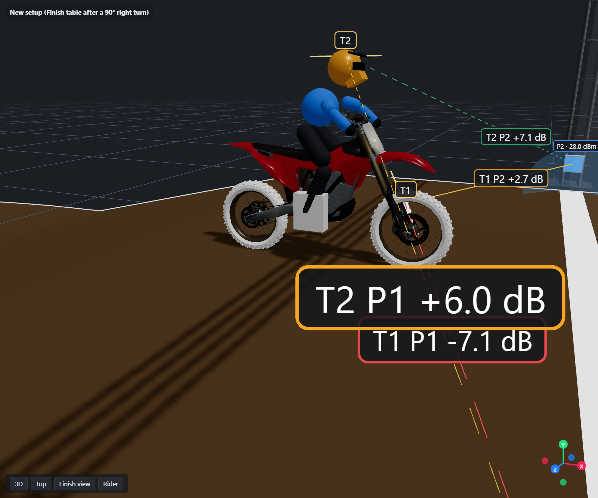

A motocross bike (the Stark Varg model, or a simple drawn bike) with a rider rides on the lane or line selected in the simulation, at the **Distance to finish** set with the slider:

- the tag is drawn at its mounting point with its **dipole axis** in yellow;
- lines to every antenna are coloured by link margin: green ≥ 6 dB, orange 0–6 dB, red dashed = no read; tag-2 lines are finely dotted.

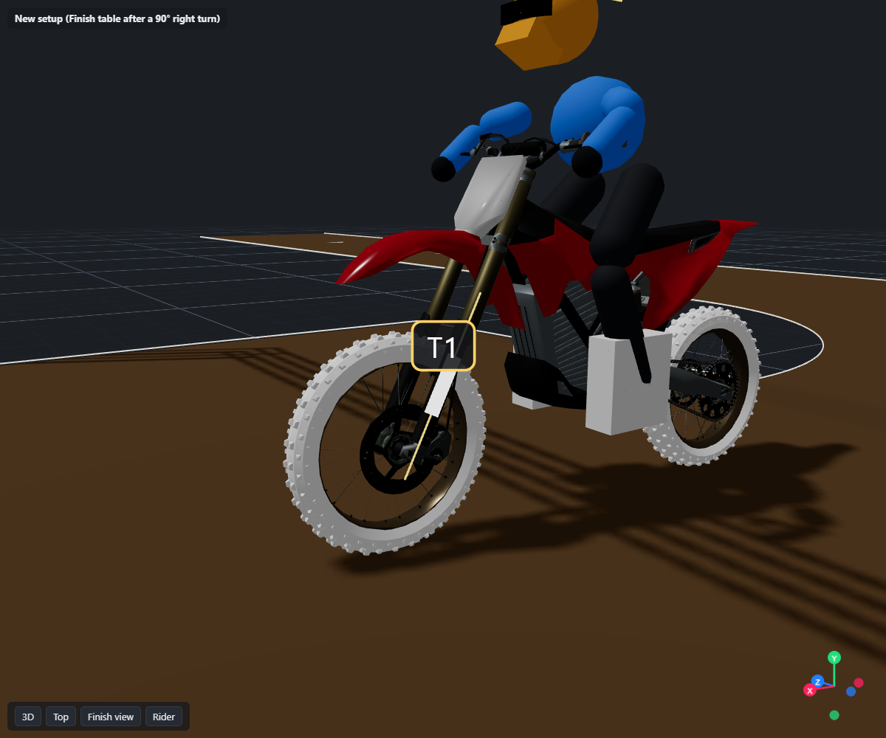

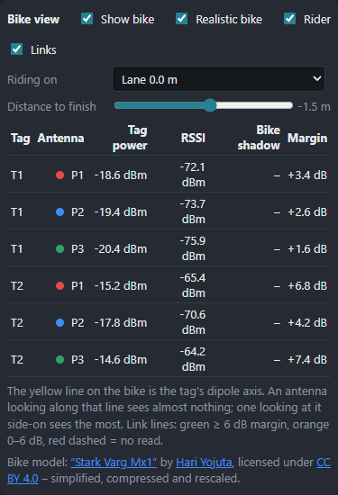

The table lists tag power, RSSI, bike shadow and margin per tag and antenna. Switches: **Show bike**, **Realistic bike**, **Rider**, **Links**, and *Realistic rider* when `web/public/models/rider.glb` exists. The drawn rider's posture follows the helmet-tag height (≈ 1.6 m seated … ≈ 1.9 m standing).

### 5.8 Antenna models

Editable models: gain (dBic), front-to-back ratio, half-power beamwidth (horizontal / vertical), polarisation. Presets:

- CAEN ETSI circular 8.5 dBic (rfid.it #1537), 70° assumed;
- generic 9 dBic circular panel, 65°;
- generic 6 dBic wide-beam panel, 100°.

Check the beamwidths against your datasheets. **+ Model** adds a copy to edit.

---

## 6. Simulation tab

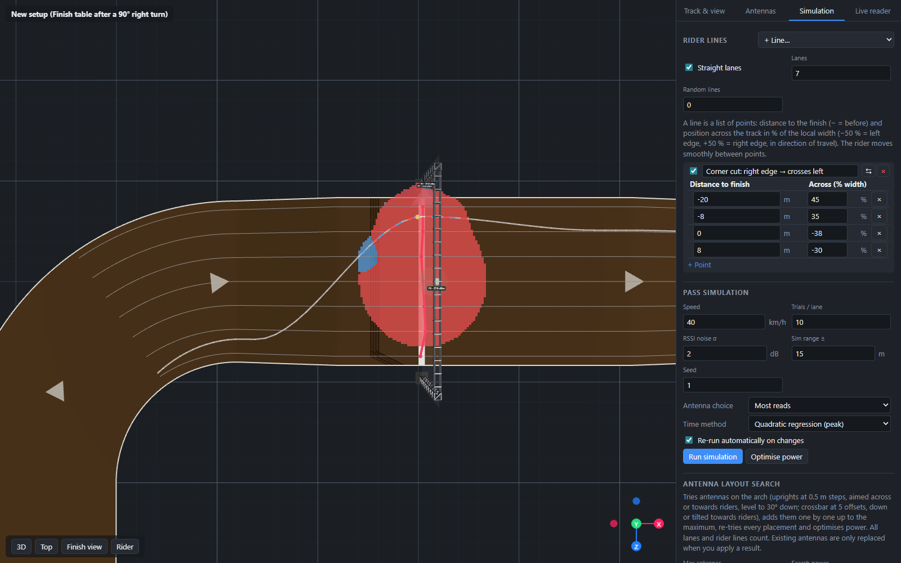

### 6.1 Rider lines

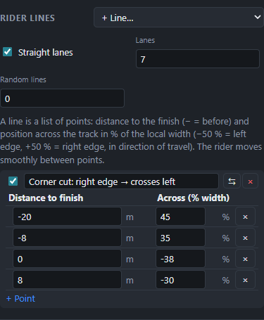

Riders rarely hold a lane. The simulation runs:

- **Straight lanes**: the given number of lanes across the track, at constant share of the width.
- **Rider lines**: points of *distance to finish* (− = before) and *position across in % of the local width* (−50 % = left edge, +50 % = right edge). The rider moves smoothly between points. **⇆** mirrors a line; **+ Point** / **×** edit points; the checkbox enables it.
- **Presets** (*+ Line…*): corner cut right edge → crosses left, corner cut left edge → crosses right, tight on the left edge, swing wide right. The finish-after-a-turn setups start with a matching corner-cut line.
- **Random lines**: extra smooth lines with random entry, crossing and exit (seeded, reproducible).

In 3D: lanes grey, rider lines orange, random lines dashed, the selected line white with its reads as dots in port colours.

### 6.2 Pass simulation settings

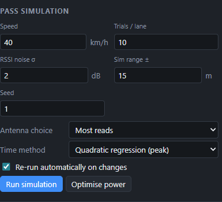

| Field | Meaning |
| --- | --- |
| Speed | Rider speed through the finish |
| Trials / line | Simulated passes per line (different noise each time) |
| RSSI noise σ | Random fading on each read |
| Sim range ± | Simulated distance before and after the finish |
| Seed | Random seed; same seed = same results |
| Antenna choice | Which antenna's reads are used for the time: **Most reads** or **Strongest read** (as in CrossMgrImpinj) |
| Time method | **Quadratic regression** (peak of an RSSI parabola), **Strongest read**, **First read** |
| Re-run automatically | Simulate after every change |

### 6.3 Virtual wall

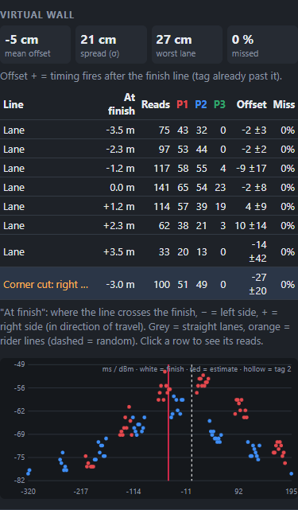

- **Mean offset**: where the timing fires on average, + = after the finish line (the tag is already past it).
- **Spread (σ)**: consistency over all passes. This decides whether close finishes are ranked correctly.
- **Worst line**: largest mean offset of any single line.
- **Missed**: passes without any time.
- Table per line: position at the finish, reads per pass (total and per port), offset ± spread, missed %. Click a row to see its reads in the chart and in 3D.
- Chart: RSSI over time (ms) per port; white = true crossing, red = estimate, hollow = tag 2.

In 3D the red line connects where the timing fires on each straight lane: the **virtual wall**. Orange dots mark it on rider lines.

### 6.4 Optimise power

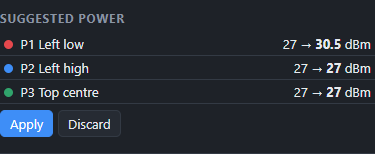

**Optimise power** searches per-antenna power (in 3, 1, 0.5 and 0.25 dB steps) within the reader and ETSI limits. It minimises this score:

```
score = 2000 × missed fraction + |mean offset| + spread + ½ × worst line + 5 × max(0, 8 − fewest reads per pass)   (cm)
```

Apply or discard the suggestion.

### 6.5 Antenna layout search

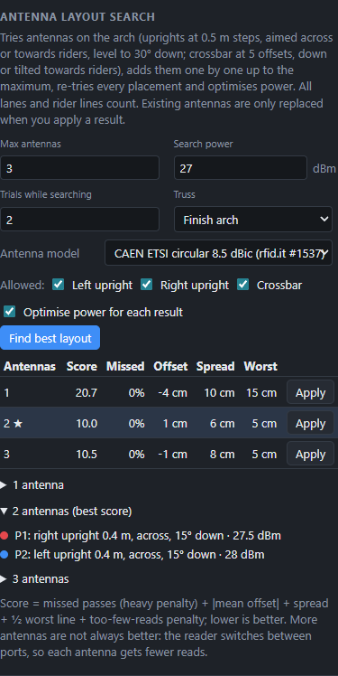

Finds the best number (1 … max), placement, aim and power of antennas on the arch:

- **Placements tried:**
  - uprights at 0.5 m height steps, aimed across the track or turned 30° towards riders, level / 15° / 30° down;
  - crossbar at five offsets, straight down or tilted 30° towards riders.
- **Search:** antennas are added one by one (best remaining placement each time), then every antenna is re-tried at every free placement.
- **Power:** optionally optimised per result.
- **Settings:** max antennas, search power, trials while searching (fewer = faster, noisier), truss, antenna model, allowed members.
- **Results:** a table per antenna count with **Apply** (replaces the current antennas). Scores within a few points are effectively equal.

A full 1–4 search takes roughly 15–60 s and runs in the background. More antennas are not always better: the reader switches between ports, so each antenna gets less read time.

---

## 7. Live reader tab

### 7.1 Impinj reader via the backend

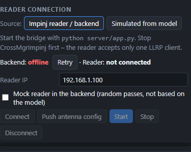

1. **Stop CrossMgrImpinj.** An Impinj reader accepts only one LLRP client.
2. Check **Backend: connected** (Docker: built in; development: `server/app.py`).
3. Enter the **Reader IP** → **Connect**.
4. **Push antenna config**: sends enabled ports and their Tx power (sllurp picks the closest power step of the reader). The receiver sensitivity is applied as a software RSSI filter.
5. **Start** / **Stop** / **Disconnect**.

The *Mock reader* checkbox uses the backend's simple random generator. It only tests the connection and is not based on your setup.

### 7.2 Simulated reader (rehearsal without hardware)

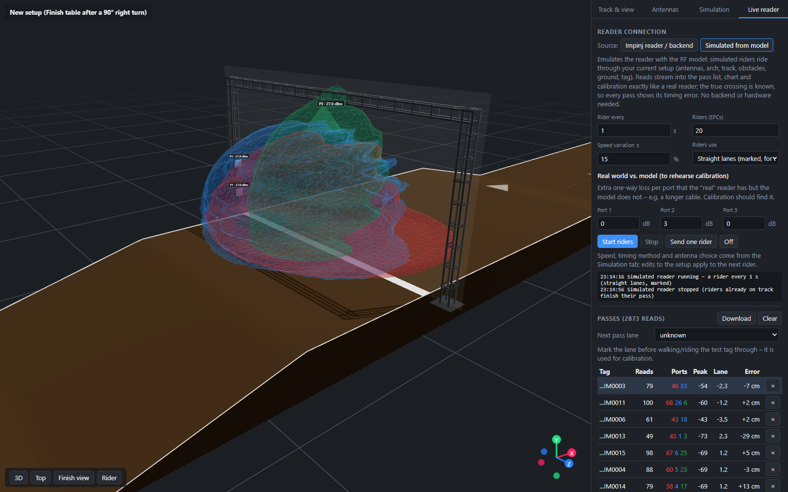

**Source: Simulated from model** runs a reader emulator in the browser, with no backend or hardware.

- **Riders from your setup:** simulated riders ride through your current setup: antennas, arch, track, obstacles, ground, tag(s), bike shadow and metal.
- **Same pipeline as a real reader:** their reads stream in real time into the pass list, chart, recording and calibration.
- **Timing error:** the true finish crossing is known, so every pass shows its timing error.

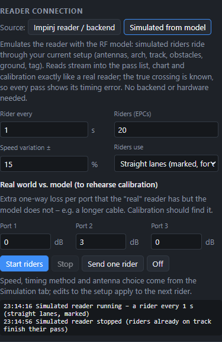

| Field | Meaning |
| --- | --- |
| Rider every | Seconds between riders |
| Riders (EPCs) | Size of the EPC pool (`SIM0001` …) |
| Speed variation ± | Around the Simulation tab's speed |
| Riders use | *Straight lanes* (marked, for calibration; uses *Next pass lane* when set) or *lanes + rider lines* (unmarked) |
| Real world vs. model | Extra one-way loss per port that the "real" reader has but the model does not, to rehearse calibration |

**Start riders** / **Stop** / **Send one rider** / **Off**. Timing method and antenna choice come from the Simulation tab.

### 7.3 Passes

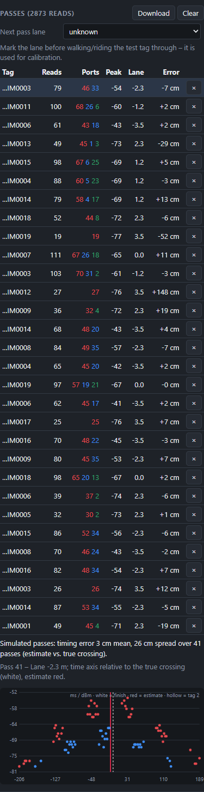

- Reads are grouped per EPC into passes. A pass closes after 1 s without reads of that tag.
- The table shows reads per port, peak RSSI, the marked lane and, for simulated passes, the timing error.
- Click a pass for its RSSI chart. The time axis is relative to the estimate, or to the true crossing for simulated passes.
- **Next pass lane**: mark the lane before walking or riding the test tag through. It's needed for calibration.
- **Download** saves setup, passes and all reads as JSON; **Clear** empties the list.

### 7.4 Calibration

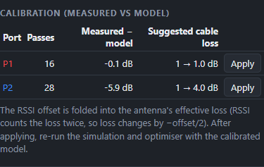

For every closed pass with a marked lane, each port's measured peak RSSI is compared with the model's noise-free peak for that lane. The measured peak is robust: the vertex of a quadratic fit, or the mean of the three strongest reads, so a single noisy read doesn't bias it.

- **Measured − model**: mean difference per port.
- **Suggested cable loss**: the offset folded into the antenna's loss (RSSI counts it twice, so the loss changes by −offset / 2). **Apply** sets it.

In the example above, the simulated reader had 3 dB extra loss on port 2. Calibration found −5.6 dB RSSI and suggests 3.8 dB cable loss (true: 4.0 dB); ports 1 and 3 stay near 0.

---

## 8. Workflows

### 8.1 At home: plan the layout

1. Build the track from your venue map: segments, radii, the table heights, widths.
2. Set the arch to your truss dimensions; place obstacles you know (hay bales, banners, barriers, the timing box).
3. Choose tag preset(s) matching your riders; set the ground types (track and surroundings).
4. Add rider lines for the realistic lines through the last turn.
5. **Find best layout**, then **Optimise power**. Check the bike view at a few positions and lines.
6. **Export** the setup file and take it to the track.

### 8.2 At the track: calibration

1. Mount the antennas as planned; measure real heights, aims and cable lengths and correct the setup.
2. Stop CrossMgrImpinj, connect the planner to the reader, **Push antenna config**, **Start**.
3. Pick a lane in **Next pass lane**, walk or ride the test tag through at normal height; repeat for 3–5 lanes, several passes each.
4. **Calibration** → **Apply** the suggested cable losses.
5. **Optimise power** again with the calibrated model, **Push antenna config**, verify with a few passes.
6. Enter the final per-port powers (and the Rx sensitivity) in CrossMgrImpinj; restart CrossMgrImpinj.

### 8.3 Rehearsal without hardware

*Live reader → Simulated from model*, set e.g. **Port 2 = +3 dB**, **Start riders**, and practise steps 3–5 above. Calibration should find the injected deviation.

---

## 9. How the model works

**Antenna pattern.** Gain G(θ) = G₀ − min(12 · (θ/HPBW)², F/B), a parabolic main lobe per plane, floored by the front-to-back ratio.

**Link budget** (866.5 MHz, free-space path loss FSPL = 20 log₁₀(4πd/λ)):

```
tag power  P_tag = P_tx − L_cable + G_ant + G_tag − FSPL − L_pol − L_body − L_metal − L_shadow − L_obstacles
reader RSSI      = P_tx − 2·(L_cable + L_pol + L_body + L_metal) − L_backscatter + 2·(G_ant + G_tag − FSPL − L_shadow − L_obstacles)
readable         ⇔ P_tag ≥ tag sensitivity  and  RSSI ≥ reader Rx sensitivity
margin           = min(P_tag − tag sensitivity, RSSI − Rx sensitivity)
```

The tag gain includes the dipole pattern: sin² of the angle between dipole axis and the direction to the antenna, floored at −20 dB.

**Ground reflection.** One ray is reflected at the specular point, which lies either on the height map of the track or on the terrain. It is weighted by the Fresnel coefficient of that surface's permittivity and conductivity: the horizontal/vertical polarisation mix follows the tag orientation, and roughness is included. The reflected ray adds coherently to the direct ray, producing peaks and dips.

**Blocking.** Obstacles attenuate each ray segment by (per crossing + per metre × path length inside), capped at 40 dB. Rays through the raised track body get *Blocked by track body*.

**Reader and passes.** Reads are attempted at the reader's read rate. The reader cycles through the enabled ports with the dwell time. Each read succeeds with ~90 % protocol probability (80 % with two tags), when the margin plus Gaussian fading (σ) is ≥ 0. Its RSSI (with fading) is rounded to 1 dB.

**Pass time.** Like CrossMgrImpinj's tag grouping: choose one antenna (most reads or strongest read), then use a quadratic fit of RSSI over time and take its peak. Fallbacks are the strongest read or the first read. The error is measured against the moment the line really crosses the finish plane.

**Numbers are only as good as the inputs.** Treat datasheet values as starting points and use the calibration.

---

## 10. Reading the results – lessons learned

These came out of the finish-table example and are worth checking for your own setup:

- **Receiver sensitivity is often the limit.** The tag gets enough power, but its reply is below the reader's Rx threshold (blue in *What limits the read*). With the example, Rx −70 dBm gave 25 % missed passes; −80 dBm (the default) gave 0 % and halved the spread. Check what CrossMgrImpinj uses.
- **Small zones or a gap under the arch?** Switch the heatmap to *What limits the read*. Violet means the tag mounting (orientation, bike shadow, metal) is the cause; moving antennas or aiming them differently helps more than power.
- **Metal kills dipole inlays.** A Dogbone directly on the fork tube missed 100 % of passes; on the fork guard (15 mm) 0 %, with 92 reads per pass; at 40 mm 172 reads.
- **Orientation matters.** An antenna looking along the tag's dipole barely reads it. The overhead antenna got **no** reads from a vertical fork tag, but 30–66 reads per pass from a horizontal tag.
- **Bike shadow.** A left-fork tag is weaker towards right-side antennas (default 6 dB, each way). With 10 dB, right-side antennas only covered the right edge.
- **Two tags with the same EPC remove misses but blur the timing.** The fork and helmet tag peak at different moments, so the merged curve fires later and less consistently:

  | Setup | Missed | Mean offset | Spread |
  | --- | --- | --- | --- |
  | Fork tag only | 0 % | −5 cm | 21 cm |
  | Fork + helmet (quadratic, most reads) | 0 % | +46 cm | 55 cm |
  | Fork + helmet (quadratic, strongest antenna) | 0 % | +54 cm | 20 cm |
  | Fork tag on metal, alone | 100 % | – | – |
  | Fork tag on metal + helmet | 0 % | +37 cm | 43 cm |

  A constant offset treats every rider the same and can be removed by moving the virtual wall; a large spread cannot. With two tags, *strongest antenna* was clearly better.
- **More antennas are not automatically better.** Port switching shares the read time. In the example the best layout had two antennas (one per upright), not three or four.
- **Test the corner-cut line.** Riders coming in on the far edge and crossing next to one side's antennas are the typical weak spot after a turn.

---

## 11. Files and data

| File | Content |
| --- | --- |
| Setup export (`*.json`) | Complete setup (version 2): track, trusses, antennas, obstacles, antenna models, reader, tags, environment, simulation settings. Older version-1 files are converted on import. |
| Live session (`live-session-*.json`) | Setup, passes and all raw reads (EPC, port, RSSI, timestamp in µs). |
| `web/public/models/stark-varg-mx1.glb` | Optimised bike model (1.4 MB); regenerate with `npm run model:optimize` from `web/public/models/source/Stark.glb`. |
| `web/public/models/rider.glb` | Optional real rider model (glTF binary, facing +Z). |
| `web/public/models/CREDITS.md` | Attribution for 3D models. |

The current setup is also kept in the browser's local storage between sessions (per browser, not shared).

---

## 12. Installation, ports and troubleshooting

| Topic | Details |
| --- | --- |
| Ports | Web app + backend: **18787** (`PORT` env var in the container, `HOST_PORT` for the published port). Dev server: 5173, proxies `/api` and `/ws` to 18787. Reader: LLRP TCP 5084. |
| "Backend: offline" | Docker: open the app via the container's port. Dev: start `server/app.py`, or run the container on 18787. |
| Docker publishes no port | Docker Desktop sometimes keeps a stale port claim (seen as `18787/tcp` without `0.0.0.0:`). Use another `HOST_PORT` or restart Docker Desktop. |
| Reader won't connect | Is CrossMgrImpinj still connected? Only one LLRP client is allowed. Check IP, network, firewall (TCP 5084). |
| Power not as expected | The reader uses the closest step of its power table; check the log line after Start. |
| `npx` blocked on Windows | Run tools via node directly: `node node_modules/vite/bin/vite.js`, `node node_modules/vitest/vitest.mjs run`. The npm scripts work as usual. |
| Slow 3D zones | Choose *Coarse* zone resolution or turn off read zones while editing. |

---

## 13. Development

```
web/                    React + TypeScript + three.js (react-three-fiber)
  src/model/            types, setup normalisation and migration
  src/rf/               RF model: pattern, link, ground, track, obstacles, lines, pass simulation,
                        optimiser, layout search (pure TS, runs in Web Workers)
  src/scene/            3D components (track, truss, antennas, zones, bike, rider)
  src/ui/               sidebar panels
  src/live/             live client (WebSocket) and simulated reader
  scripts/screenshots.mjs  regenerates the manual's screenshots
server/                 FastAPI + sllurp LLRP bridge (app.py, llrp_client.py)
docs/images/            manual screenshots
```

| Command (in `web/`) | Purpose |
| --- | --- |
| `npm run dev` | Development server (port 5173) |
| `npm test` | Unit tests (RF model, track, obstacles, lines, layout search, tags) |
| `npm run build` | Production build (served by the backend / Docker) |
| `npm run typecheck` | TypeScript check |
| `npm run model:optimize` | Rebuild the optimised bike model |
| `npm run docs:screenshots` | Regenerate `docs/images/*.png` (needs `npm run dev` running and Chrome or Edge installed; `BROWSER=` to override) |

In development, `window.store`, `window.live` and `window.__camera` expose the app state for scripting.

---

## 14. Limitations

- **Datasheet values are assumptions:** antenna beamwidths, tag sensitivities, shadow, metal and obstacle losses are typical values. The live calibration corrects antenna losses; the rest should be checked with measurements.
- **Obstacles only weaken signals:** diffraction around them and reflections off them (e.g. a metal fence acting as a mirror) are not modelled.
- **One ground reflection:** one reflected ray per path, no multiple bounces; the table edges only block rays, they don't reflect them.
- **3D zones and heatmaps assume straight travel** through the finish with tag 1's orientation; the pass simulation follows the real lines.
- **Pass time:** follows CrossMgrImpinj's approach (antenna choice + quadratic peak) as understood, not its exact code.
- **Reader model:** read-rate and protocol success are simplified; tag collisions beyond two tags are not modelled.
- **Live mode:** receiver sensitivity is applied as a software RSSI filter.

---

## 15. Credits

- Bike model: ["Stark Varg Mx1"](https://sketchfab.com/3d-models/stark-varg-mx1-50bddf268cc74f198e36068cc2e3d71c) by [Hari Yojuta](https://sketchfab.com/hariyojuta), licensed under [CC BY 4.0](http://creativecommons.org/licenses/by/4.0/); simplified, compressed and rescaled (see `web/public/models/CREDITS.md`).
- LLRP access: [sllurp](https://github.com/sllurp/sllurp). 3D: [three.js](https://threejs.org/), [react-three-fiber](https://github.com/pmndrs/react-three-fiber), [drei](https://github.com/pmndrs/drei).
- Built for use with [CrossMgr / CrossMgrImpinj](https://github.com/esitarski/CrossMgr) by Edward Sitarski.
